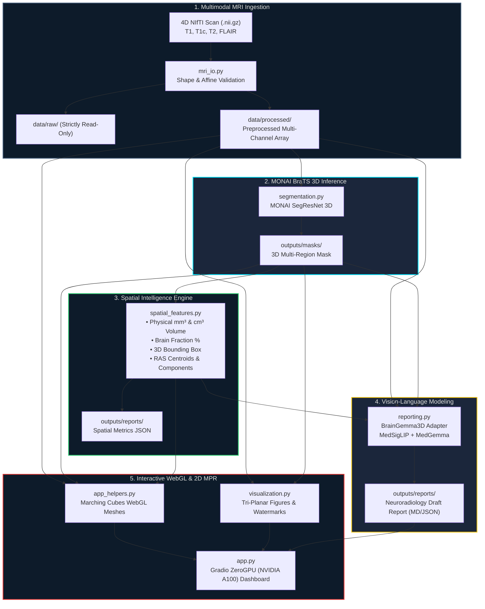

<div align="center">

# 🧠 BrainMRI-SpatialVLM
### 3D Brain MRI Spatial Intelligence & Vision-Language Model Research Platform

[](https://huggingface.co/spaces/biniya/brain-mri-vlm)
[](https://www.python.org/)
[](https://pytorch.org/)
[](https://monai.io/)
[](https://gradio.app/)
[](https://huggingface.co/spaces/biniya/brain-mri-vlm)
[](https://github.com/binibiniyam2127-cell/brain-mri-spatial-vlm)

<p align="center">
  <a href="https://huggingface.co/spaces/biniya/brain-mri-vlm">
    
  </a>
</p>

> **Mandatory Research Disclaimer:**  
> ⚠️ **AI-generated research draft — not a medical diagnosis.**  
> Developed strictly for computational neuroscience, machine learning, and medical AI research demonstration. It does not provide medical diagnoses, treatment advice, or clinical evaluations, and must **never** be used in clinical workflows or patient care decisions.

</div>

---

## 🌟 Interactive Highlights

<table>
  <tr>
    <td width="50%">
      <h3>🧊 3D WebGL Volumetric Surface Model</h3>
      <ul>
        <li><b>Full 360° Mouse Orbiting:</b> Left-click & drag to rotate through brain tissue.</li>
        <li><b>Multi-Compartment Marching Cubes:</b>
          <ul>
            <li>🔴 <b>Necrotic Core (NCR):</b> Label 1 (<code style="color:#e53935">#e53935</code>)</li>
            <li>🟢 <b>Peritumoral Edema (ED):</b> Label 2 (<code style="color:#43a047">#43a047</code>)</li>
            <li>🟠 <b>Enhancing Tumor (ET):</b> Label 3 (<code style="color:#fb8c00">#fb8c00</code>)</li>
          </ul>
        </li>
        <li><b>Scoped 3D Bounding Box:</b> Cyan wireframe (<code style="color:#00e5ff">#00e5ff</code>) shrinks dynamically around active subregions.</li>
        <li><b>3D Centroid Marker:</b> Gold diamond (<code style="color:#ffd600">#ffd600</code>) highlighting pathological epicenter.</li>
      </ul>
    </td>
    <td width="50%">
      <h3>👁️ Multi-Planar 2D Slice Explorer (MPR)</h3>
      <ul>
        <li><b>Real-Time Scrubbing:</b> Smooth 0–154 slice slider along Z, Y, and X axes.</li>
        <li><b>Tri-Planar Switching:</b> Instant toggling between <b>Axial</b>, <b>Coronal</b>, and <b>Sagittal</b>.</li>
        <li><b>Smart Lesion Autofocus:</b> Automatically lands on the slice with maximum tumor burden.</li>
        <li><b>Dynamic Alpha Compositing:</b> Contrast-normalized intensity with adjustable mask opacity (0.1–1.0).</li>
      </ul>
    </td>
  </tr>
  <tr>
    <td width="50%">
      <h3>📊 Quantitative Spatial Engine</h3>
      <ul>
        <li><b>Exact Physical Volumes:</b> $\text{cm}^3$ and $\text{mm}^3$ using NIfTI voxel spacing zooms ($dx \times dy \times dz$).</li>
        <li><b>Intracranial Burden:</b> Volume fraction % of total brain compartment.</li>
        <li><b>Topological Clustering:</b> Multi-lesion connected component analysis.</li>
        <li><b>Scanner RAS Centroids:</b> World millimeter coordinates.</li>
      </ul>
    </td>
    <td width="50%">
      <h3>📝 AI Neuroradiology Draft Synthesizer</h3>
      <ul>
        <li><b>Structured Radiology Drafts:</b> Findings and Impressions formatted to clinical neuroradiology reporting conventions.</li>
        <li><b>BrainGemma3D Multimodal VLM:</b> Integrates 3D inflated vision encoders (<a href="https://huggingface.co/google/medsiglip-448">MedSigLIP</a>) with 4-bit quantized <a href="https://huggingface.co/google/medgemma-1.5-4b-it">MedGemma</a>.</li>
        <li><b>Strict Safety Guardrails:</b> Non-diagnostic disclaimer stamped on all drafts.</li>
      </ul>
    </td>
  </tr>
</table>

---

## 🏗️ End-to-End System Architecture



---

## ⚡ Quick Start

### Option 1: Live Cloud ZeroGPU (Instant — No Installation Required)
Launch directly in your web browser with dedicated **NVIDIA A100 80GB GPU** acceleration:  
👉 **[Open Live Hugging Face Space](https://huggingface.co/spaces/biniya/brain-mri-vlm)**

---

### Option 2: Local Setup (Windows / Linux / macOS)

<details open>
<summary><b>Click to expand step-by-step local instructions</b></summary>

```powershell
# 1. Clone the repository
git clone https://github.com/binibiniyam2127-cell/brain-mri-spatial-vlm.git
cd brain-mri-spatial-vlm

# 2. Create and activate a clean Python virtual environment
python -m venv venv
# On Windows:
.\venv\Scripts\activate
# On Linux/macOS:
source venv/bin/activate

# 3. Install core dependencies
pip install -r requirements.txt

# 4. Launch the interactive platform!
python app.py
```

Open your browser at `http://127.0.0.1:7860` to access the full 3D interactive dashboard.

</details>

---

## 📂 Repository Directory Layout

```
brain_mri_spatial_vlm/
├── app.py                     # Main interactive Gradio ZeroGPU web application
├── requirements.txt           # Production dependencies
├── run_demo.bat               # Windows batch launcher (runs python app.py)
├── run_demo.ps1               # PowerShell launcher (runs python app.py)
├── README.md                  # Comprehensive architectural documentation
├── .gitignore                 # Strict git exclusions (protects weights & raw scans)
│
├── configs/
│   └── project_config.yaml    # Declarative pipeline, model & device configurations
│
├── data/
│   ├── raw/                   # Benchmark 4D MSD BraTS NIfTI scans (strictly read-only)
│   ├── annotations/           # Ground-truth multi-label reference masks (.nii.gz)
│   ├── processed/             # Inference-ready multi-sequence arrays
│   └── downloads/             # Archive extraction index
│
├── models/
│   ├── monai_brats/           # Pretrained MONAI SegResNet 3D bundle (~36 MB)
│   └── braingemma3d/          # BrainGemma3D VLM repo, MedSigLIP, MedGemma
│
├── src/                       # Production architectural framework
│   ├── __init__.py            # Package root
│   ├── config.py              # Strongly-typed dataclass configuration loader
│   ├── mri_io.py              # Robust NIfTI 3D/4D I/O and affine validator
│   ├── segmentation.py        # MONAI BraTS 3D segmentation inference adapter
│   ├── spatial_features.py    # Quantitative physical volume & geometric engine
│   ├── reporting.py           # BrainGemma3D neuroradiology draft report generator
│   ├── visualization.py       # Tri-planar visualizer with research watermarks
│   ├── app_helpers.py         # 3D Marching Cubes WebGL renderer & MPR compositing
│   ├── pipeline.py            # End-to-end multimodal pipeline orchestrator
│   └── utils.py               # Path resolution & safe timestamping
│
├── scripts/                   # Automated CLI execution runners
│   ├── download_sample_data.py # Fetches 25 public MSD BraTS benchmark cases
│   ├── download_monai_brats.py # Downloads MONAI segmentation bundle
│   ├── download_braingemma3d.py # Resilient chunked BrainGemma3D downloader
│   ├── run_pipeline.py        # Headless multimodal pipeline CLI
│   ├── run_segmentation.py    # Standalone 3D segmentation runner
│   ├── run_report.py          # Standalone draft report generator
│   └── run_visualization.py   # Standalone tri-planar visualization generator
│
├── tests/                     # Comprehensive offline test suite (79 tests)
│   ├── test_pipeline.py       # End-to-end integration tests
│   ├── test_segmentation.py   # BraTS inference & channel stacking tests
│   ├── test_spatial_features.py # Volume math, centroid & bounding box tests
│   ├── test_app_helpers.py    # 3D WebGL mesh generation tests
│   ├── test_reporting.py      # BrainGemma3D reporter & guardrail tests
│   └── ...                    # (All 13 test modules pass 100% offline)
│
├── outputs/                   # Auto-generated artifacts (isolated by category)
│   ├── masks/                 # 3D segmentation masks (.nii.gz)
│   ├── reports/               # Quantitative JSON metrics & Markdown reports
│   └── visualizations/        # High-res tri-planar and montage figures (.png)
│
└── hf_space_upload/           # Lightweight Hugging Face Spaces deployment package
```

---

## 🧬 Subregion Color Mapping & Spatial Math

<details>
<summary><b>Click to expand segmentation definitions and voxel math formulas</b></summary>

### BraTS Subregions Evaluated:
| Label ID | Clinical Subregion | Visual Color | Hex Code | Opacity | Description |
| :---: | :--- | :---: | :---: | :---: | :--- |
| **Label 1** | **Necrotic Core (NCR)** | 🔴 Red | `#e53935` | 0.90 | Hypointense on T1, non-enhancing center of lesion |
| **Label 2** | **Peritumoral Edema (ED)** | 🟢 Green | `#43a047` | 0.45 | Hyperintense vasogenic fluid infiltration on FLAIR |
| **Label 3** | **Enhancing Tumor (ET)** | 🟠 Orange | `#fb8c00` | 0.85 | Hyperintense active rim on post-contrast T1c |

### Mathematical Specifications:
- **Physical Volume ($\text{mm}^3$):**  
  $$V_{\text{subregion}} = N_{\text{voxels}} \times (dx \times dy \times dz)$$  
  *(where $dx, dy, dz$ are voxel dimensions from NIfTI zooms)*
- **Intracranial Volume Fraction (%):**  
  $$\text{Fraction} = \frac{V_{\text{pathology}}}{V_{\text{brain}}} \times 100\%$$
- **Scanner World Coordinates (RAS mm):**  
  $$\mathbf{r}_{\text{world}} = \mathbf{A} \begin{bmatrix} \bar{x}_{\text{voxel}} \\ \bar{y}_{\text{voxel}} \\ \bar{z}_{\text{voxel}} \\ 1 \end{bmatrix}$$  
  *(where $\mathbf{A}$ is the $4 \times 4$ affine transform matrix)*

</details>

---

## 💻 Headless Command-Line Runners (CLI)

<details>
<summary><b>Click to expand CLI runner commands</b></summary>

You can execute any stage of the pipeline headlessly without starting the UI:

```powershell
# 1. Full Multimodal Pipeline
python scripts/run_pipeline.py --input data/raw/Task01_BrainTumour/imagesTr/BRATS_001.nii.gz --output-dir outputs

# 2. Standalone MONAI BraTS 3D Segmentation
python scripts/run_segmentation.py --input data/raw/Task01_BrainTumour/imagesTr/BRATS_001.nii.gz --output-dir outputs/masks

# 3. Standalone BrainGemma3D Draft Reporting
python scripts/run_report.py --input data/raw/Task01_BrainTumour/imagesTr/BRATS_001.nii.gz --mask data/annotations/Task01_BrainTumour/labelsTr/BRATS_001.nii.gz --output-dir outputs/reports

# 4. Standalone Multi-Planar Visualizer
python scripts/run_visualization.py --input data/raw/Task01_BrainTumour/imagesTr/BRATS_001.nii.gz --mask data/annotations/Task01_BrainTumour/labelsTr/BRATS_001.nii.gz --output-dir outputs/visualizations
```

</details>

---

## 🧪 Verification & Test Suite

The test suite runs **100% offline** using synthetic arrays and mocked model architectures, ensuring zero weight download requirements:

```powershell
python -m pytest tests/ -v
```

```text
============================== 79 passed in 107.89s ==============================
tests/test_app_helpers.py ........                         [ 10%] (3D WebGL & Marching Cubes)
tests/test_config.py .......                               [ 18%] (Config Loader & Schema)
tests/test_model_downloads.py ....                         [ 24%] (Download Resiliency)
tests/test_mri_io.py ..........                            [ 36%] (NIfTI Dimensionality)
tests/test_pipeline.py ....                                [ 41%] (Multimodal Integration)
tests/test_project_structure.py ....                       [ 46%] (Data Protection Rules)
tests/test_report_generator.py ...                         [ 50%] (Reporter Fallbacks)
tests/test_reporting.py ......                             [ 58%] (BrainGemma3D Guardrails)
tests/test_sample_data_script.py .....                     [ 64%] (Dataset Archives)
tests/test_segmentation.py ......                          [ 72%] (MONAI BraTS 3D UNet)
tests/test_spatial_features.py ........                    [ 82%] (Physical Volume Math)
tests/test_utils.py .....                                  [ 88%] (Filesystem & Affine)
tests/test_visualization.py .........                      [100%] (Tri-Planar Watermarks)
```

---

## 🛡️ Safety, Non-Diagnostic Guardrails & Ethics

- **Non-Diagnostic Policy:** This software is intended strictly as an AI research prototype. It does not provide medical diagnoses, clinical prognosis, or treatment recommendations.
- **Mandatory Disclaimers:** All visualizations, draft reports, and interactive UI views carry the prominent watermark notice:  
  `"AI-generated research draft — not a medical diagnosis."`
- **Data Protection:** Original raw patient scans in `data/raw/` are strictly read-only and never modified during execution.

---

## 📄 Citation & Acknowledgements

If you utilize this research platform in your work, please cite:

```bibtex
@software{brainmri_spatial_vlm_2026,
  author = {Biniyam, et al.},
  title = {BrainMRI-SpatialVLM: 3D Brain MRI Spatial Intelligence & Vision-Language Model Research Platform},
  year = {2026},
  publisher = {GitHub},
  url = {https://github.com/binibiniyam2127-cell/brain-mri-spatial-vlm}
}
```

*Built with [MONAI](https://monai.io/), [Hugging Face ZeroGPU](https://huggingface.co/spaces), [BrainGemma3D](https://huggingface.co/praiselab-picuslab/BrainGemma3D), [Plotly](https://plotly.com/), and [Gradio](https://gradio.app/).*
